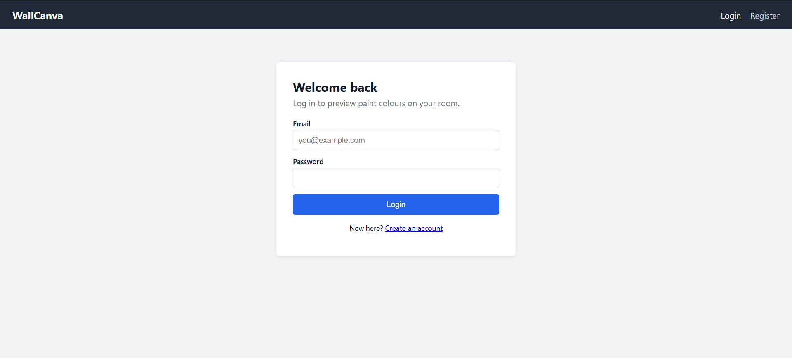
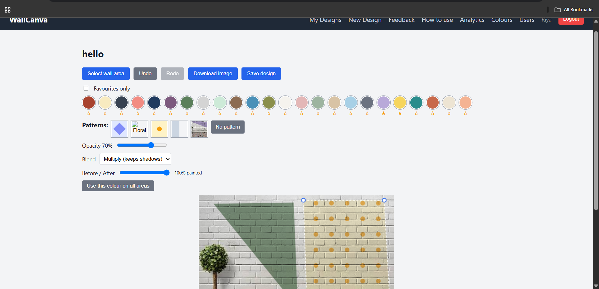
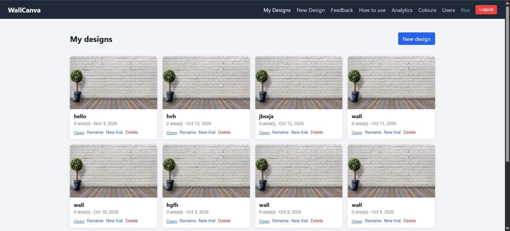
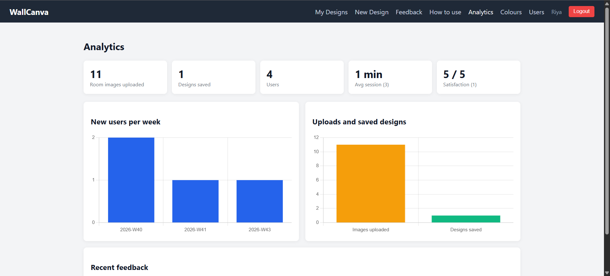

# WallCanva

Smart Wall Paint Visualizer: upload a photo of your room, select wall areas, and preview paint colours and patterns before you paint.

**Live demo:** https://wall-canva.vercel.app/
**API:** https://wallcanva-api.onrender.com/api/health
(The API runs on a free plan, so the first request can take about 30 seconds.)

## Features
- Register and login (JWT), user and admin roles
- Upload a room photo (JPG/PNG, up to 5 MB)
- Select wall areas with a polygon tool, edit points by dragging
- Apply colours or patterns with opacity and blend modes
- Dual-tone walls (each area has its own colour)
- Undo/redo, before/after slider, download as PNG
- Save, rename, duplicate (new trial) and delete designs
- Favourite colours
- Admin: manage colours and patterns, view users and their designs
- Analytics dashboard (uploads, saved designs, new users, session time, feedback)

## Screenshots





Full requirements: [PRD](docs/PRD.md)

## Tech stack
Angular, Node.js, Express, MongoDB Atlas, Cloudinary, Chart.js. Hosted on Vercel (client) and Render (server).

## Project structure
```
client/   Angular app
server/   Express API
docs/     PRD, schema diagram, API notes
```


## Run locally
Requirements: Node 20.19+ or 22.12+, a MongoDB Atlas database, a Cloudinary account.

**Server**
```
cd server
npm install
copy .env.example .env # then fill in the values
npm run seed # optional: demo colours, patterns, admin
npm run dev
```


**Client**
```
cd client
npm install --legacy-peer-deps
ng serve
```

Open http://localhost:4200.

## Environment variables (server/.env)
| Name | Purpose |
|---|---|
| PORT | API port (default 5000) |
| MONGO_URI | MongoDB Atlas connection string, including the database name |
| JWT_SECRET | Secret used to sign login tokens |
| CLIENT_URL | Frontend URL allowed by CORS |
| CLOUDINARY_CLOUD_NAME, CLOUDINARY_API_KEY, CLOUDINARY_API_SECRET | Image storage |
| SEED_ADMIN_EMAIL, SEED_ADMIN_PASSWORD | Optional, used by `npm run seed` |

## Deployment
- **Server:** Render web service, root directory `server`, start command `node src/server.js`.
- **Client:** Vercel, root directory `client`, with `vercel.json` rewriting all routes to `index.html`.
- Both deploy from the `main` branch.

## API endpoints
See `docs/API.md`.

## Disclaimer
Colours may vary due to lighting, screen calibration and wall texture. Treat the preview as a guide.
